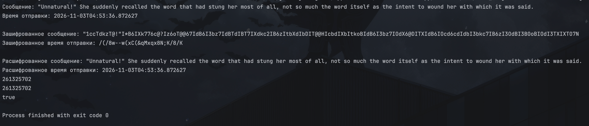

# Text-Encryptor



Консольная программа на Java, которая шифрует и расшифровывает сообщение вместе со временем отправки.

## Как это работает

- Каждая буква, цифра и спецсимвол из алфавита заменяется другим символом по ключу.
- Ключ создаётся случайно при каждом запуске программы.
- Время отправки превращается в строку, шифруется так же, как текст, и при расшифровке возвращается обратно в дату.
- Символы вне алфавита (например, кавычки или русские буквы) не меняются.

## Структура

- `Main` - запуск и проверка
- `encrypt/Encryptor` - интерфейс шифра
- `encrypt/DefaultEncryptor` - шифр подстановки
- `encrypt/MessageEncryptor` - шифрует сообщение целиком (текст и время)
- `model/Message` - исходное сообщение
- `model/EncryptedMessage` - зашифрованное сообщение

## Запуск

Нужен JDK 17 или новее. Откройте проект в IntelliJ IDEA и запустите `Main`.

Или из терминала:

```bash
javac -d out $(find src -name "*.java")
java -cp out Main
```

## Важно

Ключ хранится только в памяти, поэтому после перезапуска программы старое сообщение расшифровать нельзя. Проект учебный: такой шифр легко взломать.